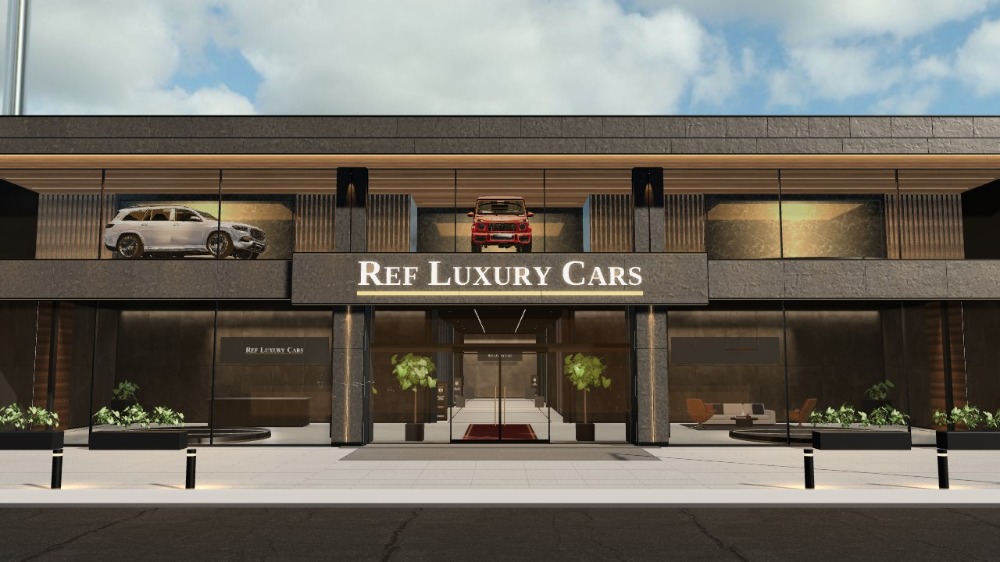
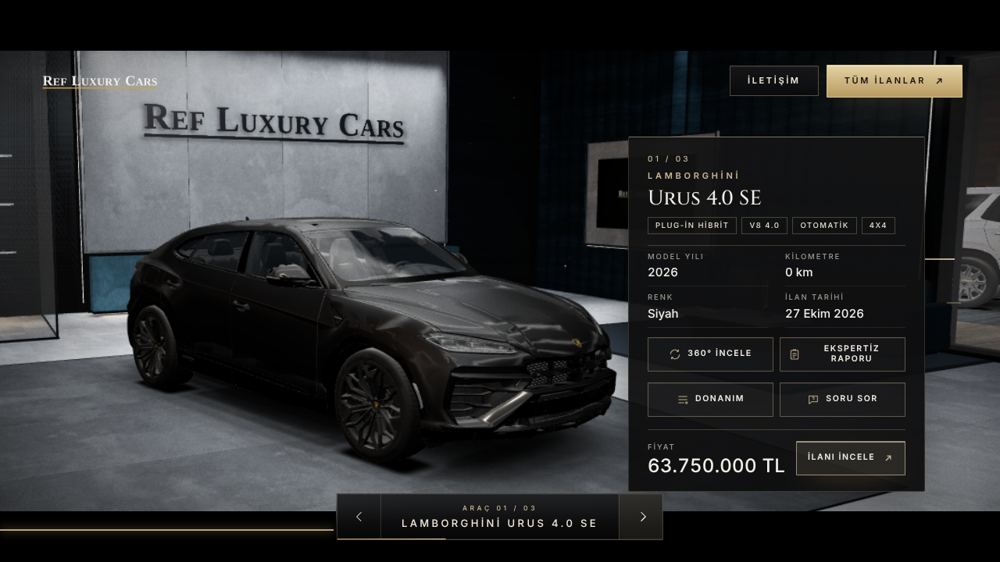

# REF LUXURY CARS: 3D showroom demosu (firmaya tanıtım)

Garden Motors tasarımının aynısı (`site/garden-motors`); değişen yalnız firma adı ve salonlardaki ilanlar.
Kaynak: refluxurycars.sahibinden.com mağaza listesi (27.10.2026), 3 araç.

| Salon | Araç | Renk | Fiyat |
|---|---|---|---|
| 1 | 2026 Lamborghini Urus 4.0 SE | Siyah | 63.750.000 TL |
| 2 | 2026 Cadillac Escalade 6.2 V8 V-Series | Beyaz | 55.750.000 TL |
| 3 | 2026 Lexus LX 600 Luxury 7 Kişilik | Siyah | 39.950.000 TL |

Firmaya özel yerler (index.html / src/theme/facadeTheme.js):
- `GALLERY` (ad, mağaza linki, telefon, WhatsApp; REF numarası verilmediği için telefon düğmeleri gizli), `BRAND`, `CARS`
- `TH.sign.words = ['REF', 'LUXURY', 'CARS']`, `TH.sign.icon = 'none'` (Garden filizi yok), `palette.brand` (beyaz + altın)
- Logo: `firma_logo.py logo.png "REF,LUXURY,CARS" "#f2efe8" "#c9a24b"`

Çalıştırmak için Garden Motors'taki `models/` (rooms, decor, vitrin), `public/textures`, `public/hdri`, `textures/` klasörleri gerekir.
Mail taslağı: `mail_taslagi.md`.

