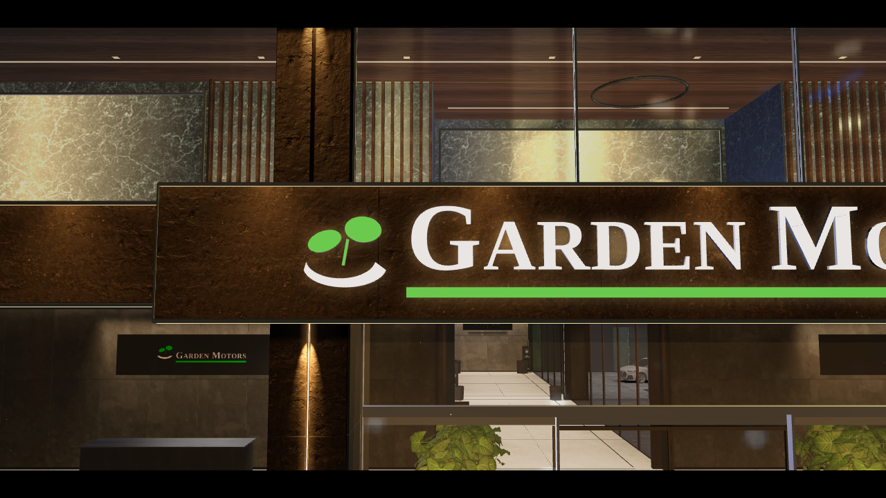
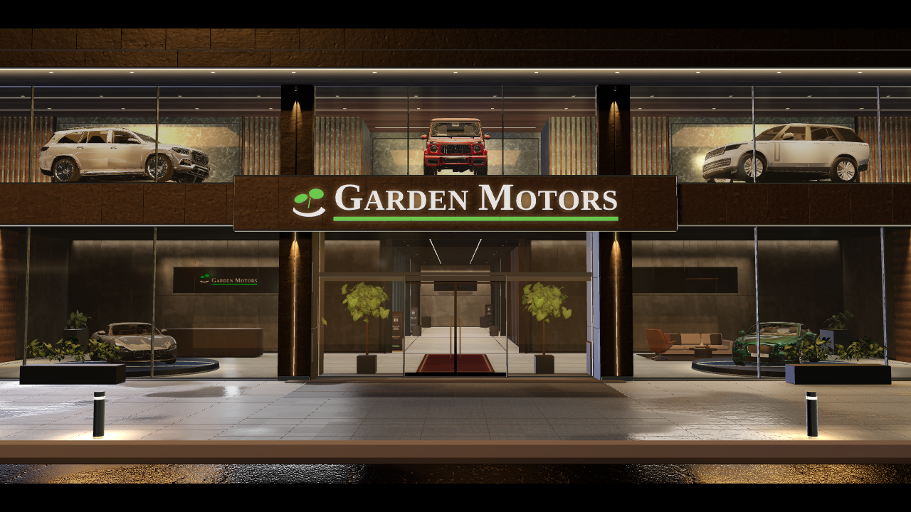

# Garden Motors — dış cephe PBR güncellemesi (taslak)

`index.html`, sitenin proje klasöründeki dosyanın yerine geçer. Yeni dokular repo kökündeki `public/` klasöründedir
(`npm run assets`); sitenin klasörüne `public/` olarak kopyalanmalıdır.

Değişiklikler (yalnız dış mekân, `EXT_CFG` ayarları):
- Yol: Poly Haven `asphalt_02` (gerçek ölçek, eski nem/parlaklık korunur)
- Plaza zemini: `granite_tile` (Blender pişmiş ışığı korunur)
- Giriş saçağı / bant / bordür: `concrete_floor_worn_001`
- Doğramalar, babalar, lambalar: `blue_metal_plate` normal + pürüzlülük, koyu grafit renk
- Gece HDRI (`modern_buildings_night`): metal ve cam yansımaları (telefonda indirilmez)

Karşılaştırma görüntüleri: `D_karsilastirma_yakin.png`, `D_karsilastirma_hero.png`.

## Mimari derinlik (cephe katmanları)
Ölçüler `src/theme/facadeTheme.js` → `depth` içinde; kod `index.html` → `facadeDepth()`.

| Katman (önden arkaya) | Konum |
|---|---|
| Çatı plağı | cephe hattından 1.5 m önde, 50 cm kalın; altı ahşap, alnında LED; üstünde 60 cm parapet + metal harpuşta |
| Kolonlar | camın 25 cm önünde, zeminden çatıya kesintisiz (bant kolonların gerisinde) |
| Üst kat bandı | camın 15 cm önünde, alt kenarında 4.5 cm koyu gölge derzi |
| Doğrama | camın 5 cm önünde; cam kenarlarında 5 mm koyu silikon derz |
| Cam | z = 0.20 |
| Giriş | cam duvar yan vitrinin 80 cm gerisinde; kasa öne çıkmaz, ahşap tavan devam eder |

Bina uçları: yan cephe 3.6 m görünür derinlikte (pahlı paneller + 3 dar cam yarığı), komşu parsele 26 m koyu duvar + çıta çit.
Çatıda sönük iki mekanik ünite. Gölge: önden-soldan sokak ışığı yıkaması (3000 K), 2048 gölge haritası, normalBias .04;
statik olduğu için akıcı modda da açık (telefonda kapalı). Panel kenarları 5 mm pahlı (RoundedBox).
Yan duvarlar ve yeni yan paneller gece HDRI'sinin gök yansımasını almaz (lavanta tonu bu yansımadan geliyordu); çatı üstü koyu membran.

Önce / sonra: `screenshots/derinlik/onceSonra_1.jpg` (önden, 3/4 sağ), `_2` (giriş yakın, 3/4 sol), `_3` (yukarıdan, sağ uç).

## Dış kolonlar (`createColumn`)
Bütün dış kolonlar (iki uç + giriş portalının iki yanı) tek fonksiyondan gelir: `createColumn(width, height, depth, variant)`;
ayarlar `facadeTheme.js` → `columns`. Eski ince plaka ızgarası, kolonlardaki aplikler ve zemin ışık diskleri kaldırıldı.
- **A (varsayılan) monolit + LED girinti:** ortada 4 × 3 cm girintiyle ayrılmış iki yarı; her yarı 3 uzun plaka (4 mm derz,
  8 mm pah, plaka başına farklı doku kaydırması); structure, roughness .35 + clearcoat .4. Girinti dibinde 3000 K şerit,
  yan yüzlerinde LED'den sönen katkılı ışık gradyanı.
- **B dikey lamel:** #151617 çekirdek, önde ve yanlarda 4 cm derin 1.5 cm kalın alüminyum lameller (6 cm aralık, InstancedMesh).
- İkisinde de: 12 cm metal kaide (2 cm içeride) + 3 cm koyu gölge boşluğu; üstte saçakla arasında 3 cm gölge boşluğu;
  önde zemine gömülü halka + yukarı bakan dar spot (0.15 rad, penumbra .5, 3000 K, gölgesiz). Spot, kendi yarı açısı kadar
  yüze eğik: ışık yüze ~70 cm'den değer, yukarı doğru söner. Telefonda spotlar yok (yalnız halka).
- lil-gui → Cephe → **Kolonlar**: varyant (A/B), LED şiddeti, girinti yan ışığı, yalayan ışık, girinti genişliği.

A / B karşılaştırma: `screenshots/kolon/AB_karsilastirma.jpg`.

## Üst kat duvarı, vitrin araçları, bant dokusu
Ayarlar `facadeTheme.js` → `upper`, `display`, `band`; kod `buildUpperGallery()`, `facBandMats()`, `displayPlinth()` / `displaySpot()`.
- **Üst kat duvarı:** düz ceviz duvar yerine cilalı koyu mermer (`dark_stone`) arka plan; nişler dışında mermerin 3 cm önünde
  dikey ceviz lameller, altta ve üstte sıcak LED çizgisi ve duvara düşen yıkama. Her aracın arkasında lamel yüzünden 15 cm geride,
  metal çerçeveli niş; arkasında araçtan yukarı ve kenarlara sönen sıcak ışıma (araç silüeti öne çıkar, tabeladan sönük).
- **Araçlar:** her araca cam önü tavanından gölgesiz spot, üst ışıklar güçlendirildi; kaide tabanında geri çekilmiş ışık çizgisi
  ve zeminde yumuşak hale (araç yüzer gibi), pirinç kenar çizgisi daha belirgin.
- **Bant (tabelanın arkası):** düz boya yerine fırçalanmış koyu alüminyum kompozit (`brushed_metal` normal + pürüzlülük,
  yatay fırça izi), komşu paneller ±%6 farklı tonda.

Önce / sonra: `screenshots/ust-kat/onceSonra_ust1.jpg` (önden, 3/4), `onceSonra_ust2.jpg` (üst kat yakın, zemin vitrin).

## Dış duvarlar: taranmış PBR, dünya koordinatlı (`src/materials/worldUV.js`)
Kolonlar, yan duvarlar, parapet ve bina uçları (tabela yanındaki kompozit bant hariç) ambientCG taramalarıyla kaplıdır:
**taş Rock041 (varsayılan)**, beton Concrete029 (lil-gui seçeneği), kir maskesi Leaking005. Dokular repo kökündeki
`public/textures/wall_stone|wall_concrete|grime_mask` klasörlerindedir, sitenin `public/textures/` klasörüne kopyalanmalıdır.
Ayarlar `facadeTheme.js` → `walls`, `paving`, `lightTemp`, `whiteBalance`.

- **Triplanar örnekleme:** UV yok, doku dünya koordinatından gelir (her yüzeyde aynı ölçek, gerilme yok). Normal haritası
  "whiteout" karışımıyla dünya uzayına çevrilir. Türevler dallanmanın dışında hesaplanıp `textureGrad` ile verilir (köşelerde
  yanlış mip seçimi olmaz); doku en/boy oranı (`aspect`, Rock041 2:1) düzeltilir; anizotropi en yüksek değerde.
- **Renk:** her dokunun doğrusal ortalaması (`avg`) kayıtlı; kanal başına çarpan ortalamayı `albedo` hedefine çeker
  (duvar `#5a5652`, açık-orta gri). lil-gui'de renk seçici var.
- **Plakalama:** 120 × 300 cm plakalar, 5 mm derz; plaka başına doku kaydırması, 180° döndürme, ±%7 ton ve ±.08 pürüzlülük.
  Parapet ve saçak kenarlarının altında 70 cm'lik kir akıntısı (opaklık .4), zemine değen 25 cm'de koyulaşma.
- **Işık:** `kelvinToColor` artık Planck eğrisinin CIE 1931 yaklaşımı (eski Tanner Helland formülü aynı K'de daha turuncuydu).
  Bütün dış cephe ışıkları aynı renkten gelir: `facadeLightColor() = kelvinToColor(lightTemp 3500, whiteBalance 4700)`.
  Beyaz dengesi kamera gibi çalışır. 3500 K tek başına doğrusal uzayda (1, .57, .25) demektir ve gri taşı turuncuya boyar;
  4700 K beyaz dengesiyle ışık `#ffe1b6` olur ve taş sıcak ışık altında gri kalır (lil-gui → ışık / gök → beyaz dengesi).
- **Yalayan ışık:** kolon ve duvar dibinde gölgesiz spot; açı .3, penumbra .8, şiddet 2.2 (en parlak nokta tone mapping'de patlamaz).
- **Yaya zemini:** giriş önü kaldırım aynı taş dokusuyla, dünya ızgarasına oturan 60 × 60 cm karolar, 3 mm derz, karo başına
  ofset/ton; orta-koyu gri (`#4a4845`, giriş şeridi `#33312f`). Blender'ın pişmiş ışık haritası korunur.
- **Saksılar:** palet dışı terakota saksılar (vitrin ve resepsiyon) structure malzemesinde mat, dikdörtgen saksılarla değiştirildi.
- lil-gui → Cephe → **Duvarlar**: malzeme (taş/beton), ortalama renk, textureWorldSize, normalScale (1.5), kir opaklığı,
  yalayan ışık, plaka varyasyonu.

Teşhis (kolon, 2 m): `screenshots/duvar/teshis_ab.jpg`: uplight'lar kapalı ve nötr yan ışık altında bile kolon turuncuydu
(sebep: 3000 K cephe ışığı ve dokunun sıcak kahve ortalaması). Renk haritası tek başına net ve doğru ölçekteydi.
Önce / sonra (açılış, kapıya yarı yol, kolona 2 m): `screenshots/duvar/once_sonra_duvar.jpg`; taş / beton: `tas_beton_yeni.jpg`.

## Referans görsele göre cephe (lamel bant, koyu taş, ıslak zemin)
Hedef: kanal sahibinin referans render'ı (`screenshots/referans/referans.jpg`). Fark analizi ve yapılanlar:

| Alan | Referans | Önceki site | Şimdi |
|---|---|---|---|
| Tabela arkası bant | boydan boya siyah yatay alüminyum lamel, kolonların önünden geçer | düz koyu kompozit panel, dikey derzli, kolonların arkasında | `buildLouverBand()`: 7 cm aralıklı, 12° eğik lameller (üst yüzleri ışığı yakalar), koyu arka yüz, metal başlık/kapak, alt kenarda aşağı bakan ince LED. Bant kolonların 10 cm önünde, uç kolonlara dayanır |
| Tabela | bantın önüne çıkan ayrı lamel kutu, parlak beyaz harf + hale | bant düzleminde mat panel, sönük harf | 12.4 × 1.56 m kutu, bantın 22 cm önünde; harf ışığı 1.05, yeşil .62, hale .42 |
| Kolon + çatı alnı | koyu antrasit damarlı taş plakalar | açık gri taş (kolon), kompozit (alın) | aynı Rock041 taşı, albedo `#3d3c3a`; çatı alnı 2.4 m taş plakalar |
| Kolon ışığı | yüze monte silindir armatür, aşağı dar ışın | zeminden yukarı yalayan spot | her kolonda iki armatür (bant altı, saçak altı), 10 cm kol, aşağı bakan dar spot (şiddet 36); yüze ~40 cm altta değer, aşağı söner |
| Saçak kenarı | sürekli parlak LED çizgi, ahşaba yayılan ışık | ince sönük LED | 3 cm LED + ahşap tavana 1.4 m katkılı ışık gradyanı |
| Zemin | yağmur sonrası ıslak yol ve taş, ışıkların dikey süzülmesi | kuru (HD'de yarı saydam ayna yol) | `src/materials/wetGround.js`: Reflector görüntüsü yol ve kaldırım malzemesinde okunur; dikey bulanıklık, Fresnel, birikinti maskesi, ıslak yerde koyulaşma + düşük pürüzlülük. Yalnız HD ve dışarıdayken |
| Babalar | tepede parlak ışık halkası, zeminde ışık havuzu | siyah, sönük | LED halka ×6, zeminde 1.3 m ışık havuzu (ıslak zeminde süzülür) |
| Gök | bulutlu gece | düz gradyan | fbm bulut katmanı, alt yüzü şehir ışığıyla hafif sıcak |
| Saksılar | gür, sık bitki | seyrek | dikim aralığı 62 → 40 cm, boy çeşitliliği |

lil-gui → Cephe: **Islak zemin** (yansıma, ıslaklık, süzülme); kolon ışığı Kolonlar klasöründe.
Hata düzeltmesi: giriş lobisini aydınlatan 15 × 3 m alan ışığı (`entranceLight`) kolon yüzlerinin 5 cm önündeydi; düzlemi kolonu
y ≈ 2.85 m'de kesip altını aşırı aydınlatıyor, üstünü karanlık bırakıyordu (plakalar arasında keskin çizgi). Cam hattına (z .12) alındı.

Kalan farklar (sonraki tur): referans genel olarak daha sıcak (iç mekân turuncu, ahşap parlıyor); yoldaki yansımalar referansta
her ışık için ayrı ince dikey çizgi, bizde daha geniş; iç mekânda giriş yanlarında saksı ağaçlar.
Karşılaştırma: `screenshots/referans/karsilastirma.jpg`.

### 2. tur: referansın canlı ışığı birebir
- **Işık rengi:** 3000 K, beyaz dengesi düzeltmesi yok (6500) → referanstaki canlı sıcak turuncu (`#ffbd73`). Koyu taş kolonlar
  turuncu ışık huzmesi altında referanstaki gibi görünür.
- **Kolonlar:** giriş kolonlarında yalnız zemin katta parlak dikey LED (bant altına kadar) + ön yüzde dar sıcak ışıma;
  uç kolonlarda zeminden yukarı dar ışık (altta parlak). Üst armatürler aşağı vurmaya devam eder.
- **Üst kat:** niş arkası mermer daha parlak (lightBox 1.0), ahşap lamellere yıkama 1.3, ahşap tavanda cepheye paralel iki çizgi LED.
- **Saçak:** LED 5, ahşaba yayılan ışık 1.0 (1.6 m).
- **Giriş lobisi:** kapının iki yanında koyu kare saksıda yapraklı ağaç (`lobbyTrees()`).
- **Saksılar:** 30 cm aralıkla iki-üç sıra gür bitki.
- **Kaldırım:** referanstaki gibi açık-orta gri (`#7a766f`) 120 × 60 cm karo; giriş şeridi `#4a4743`.
- **Islak yol:** her ışık için uzun, kırık dikey süzülme (33 örnekli üstel çekirdek, yüzey dalgası), parlak kaynaklar güçlendirilir;
  yansıma şiddeti 1.5.
- **Babalar:** LED ×10, zeminde 1.4 m ışık havuzu.

Karşılaştırma (referans / 1. tur / 2. tur): `screenshots/referans/karsilastirma2.jpg`.

### Titreşim düzeltmesi (kanal sahibinin ekran kaydı)
Kayıtta açılış karesi (kamera ±7° yavaş salınım + nefes) dururken bazı yerler kare kare değişiyordu. Ölçüm (kareler arası fark haritası):
- **Çatı alnı (en çok):** taş plakaların ön yüzü Blender çatı plağının ön yüzüyle aynı düzlemdeydi (z-fighting); gökyüzünü yansıtan
  plak ile taş kare kare yer değiştirip mavi lekeler yanıp sönüyordu. Plak 1.5 cm geri alındı. Lamel bant başlık/kapağı da Blender
  bant kütlesinin alt/üst yüzüyle aynı kottaydı → 1 cm taşırıldı. Saçak ve kolon ışıma düzlemlerine polygonOffset.
- **Giriş kolonu, armatürün altı:** çok güçlü ve yüze çok yakın spot + tümsekli taşta çok düşük pürüzlülük = speküler aliasing:
  pikseller bir beyaz bir siyah, kameranın piksel altı kaymasıyla titriyordu. worldUV'ye normal türevine bağlı pürüzlülük artışı
  (speküler kenar yumuşatma) ve taş için en düşük pürüzlülük .45; ıslak zemine de aynı koruma; armatür 14 cm dışarı, şiddet 24.
- **Üst kat mermer:** normal haritası .5 → .22, pürüzlülük .5.
- **Lamel bant:** 32 m'ye gerilen fırça pürüzlülük haritası uzakta moiré yapıyordu → kaldırıldı (sabit pürüzlülük).

### Açılış kamerası ve Mercedes odası logosu
- **Açılış:** 29 m → 19.5 m (göz 2.1 m, bakış 2.75 m); cephe ekranı doldurur, giriş kolonları ekranın %34 / %66'sında (2.24:1 ekran).
  Telefon 32 → 27 m.
- **Oda 1 (Executive Sedan Lounge, Mercedes E 180):** açık gri taşta beyaz baskı logo okunmuyordu. Tema bayrağı `brandPanel` ile
  `brandLogoPanel()`: duvardan 4 cm ayrık siyah saten levha (hafif cila), 1.2 cm fırçalanmış çelik çerçeve, duvara yumuşak elips arka ışık,
  logo levhanın önünde hafif ışıklı. Diğer odalara aynı bayrakla açılabilir. `screenshots/oda/mercedes_logo_panel.png`.

## Premium arayüz, ilan detayı, soru sor, fare paralaksı
- **Butonlar:** kömür siyahı cam zemin, 1 px şampanya çizgi, geniş harf aralığı, üzerine gelince ince ışık süpürmesi; ana eylem
  şampanya altın degrade. Stil betiğin sonunda eklenir (`#gm-premium`, `body.gm`).
- **Gezinme çubuğu:** iki satır (küçük bölüm etiketi: "Garden Motors" / "Araç 01 / 03" / "Koleksiyon" + büyük ad), ince ok ikonları,
  altta turun ilerleme çizgisi.
- **Telefon:** `GALLERY.phones = ['0533 542 30 90']`, `GALLERY.whatsapp = '905335423090'`. Açılışta iki satırlı "Hemen arayın" ve
  "WhatsApp" düğmeleri; yanında **ilandaki markaların logoları** (`public/brand/cars/*.png`, beyaz, şeffaf; Simple Icons SVG'sinden
  üretildi). Logoya tıklayınca o markanın ilk aracına gidilir. Yeni marka: `GALLERY.brandLogos` + PNG.
- **İlan detayı paneli** (kartta "Donanım" ve "Soru Sor"): Özet (ekspertiz kontrolleri, boya notu, bakım), Donanım (kategorili),
  Soru Sor (hazır soru etiketleri, ad / telefon / soru). Gönderim **Netlify Forms** (`arac-soru`): Netlify → Forms → arac-soru;
  e-posta bildirimi oradan açılır. Gönderilemezse (yerel önizleme) WhatsApp'a hazır metinle yönlendirir. Bot tuzağı alanı var.
- **Mercedes E 180 verisi** (`CARS[0]`): başlık, etiketler (156 HP · Benzin · Otomatik · F1 Vites), ekspertiz (sol ön + sol arka kapı
  lokal boyalı = "kordon altı boya", tramer yok, şase / podye / airbag orijinal, değişen yok, bakım notları) ve 35 maddelik donanım.
  Tekrarlar birleştirildi (Hız Sabitleme = Cruise Control, iki arka perde maddesi).
- **Fare paralaksı:** durakta kamera bakılan noktanın etrafında ±3.2° yatay, ±1.6° dikey döner (geçişte kısık; dokunmatikte yok;
  ekspertiz / panel açıkken kapalı; fare pencereden çıkınca merkeze döner).
Ekran görüntüleri: `screenshots/arayuz/`.

### Kamera akıcılığı, düğme hatası, duvar logosu, sade açılış
- **Camdan salona giriş (ekran kaydı analizi):** kare kare yatay kayma ölçüldü; kamera sola dönerken geri sağa dönüyor, varışta ters
  yönde kayıyordu. Sebep: bakış yönü / eğim / mesafe / görüş açısı anahtar kareler arasında Catmull-Rom ile hesaplanıyordu; büyük
  dönüşün (koridor → salon) ardından küçük dönüş gelince hedefi aşıp geri dönüyordu (+4.6° sağa kaçış, −67.5°'ye taşma). Şimdi
  monoton kübik (`crm`, Fritsch–Carlson): hedefi aşmaz. Koridor dolly ve salon açılışı karelerinin bakışı girişle araç kadrajı
  arasına sıkıştırıldı (`monoYaw`): 0° → −64.5° tek yönde. Kare süresi yumuşatılıyor (`smDt`): düzensiz kare sürelerinde takılma azalır.
- **Kart düğmeleri basılmıyordu:** gizli bilgi panelinin CSS'i `display:flex` olduğu için `hidden` çalışmıyor, görünmez panel kartın
  üstünü örtüyordu. `#gm-sheet[hidden]{display:none}`. 360° incele, Ekspertiz, Donanım, Soru Sor, İlanı İncele tıklanarak denendi.
- **Mercedes odası logosu:** siyah levha kaldırıldı. Duvara takılı grafit metal kabartma harf (yeşil çizgi / yapraklar korunur),
  8 mm koyu kenar katmanı, duvarda yumuşak gölge; %40 daha büyük (`brandWallLogo`).
- **Açılış:** masaüstü tam karşıdan, 21.5 m, bakış 3.55 m: üst kattaki araçlar menünün altında net; açılışta fare paralaksı yok
  (kadraj ortada sabit). Telefon 36 m: camların arkasındaki araçlar görünür.
- **Sade arayüz:** kalite (AKICI / HD) ve ses düğmeleri kaldırıldı; site her zaman akıcı modda. "İlandaki markalar" yazısı kaldırıldı.

## Prestij vitrini (görsel amaçlı)
`VITRINE` listesi (index.html): zemin kat Ferrari Roma + Bentley Continental GT V8 yuvarlak döner kaidede (Ø 5.3 m, koyu cilalı gövde,
şampanya kenar halkası, tabanda gömme LED, zeminde hale); üst kat G 63 + Range Rover oval kaidede yan profil (cam ile mermer arası
3.8 m). Araçların kendi boyaları korunur; ağır "transmission" camı hafif saydam cama çevrilir. Modeller arka planda yüklenir;
telefonda yalnız zemin kat. Kaynaklar sayfa sonunda ve `models/vitrin/LISANS.md`. Toplam 11 MB (orijinal 103 MB), ~650 bin üçgen.

### Tabelanın üstü: Maybach GLS 600 + taş bant
- Üst katın ortasında (tabela kutusunun üstü) kırmızı **Mercedes-AMG G 63** durur, burnu sokağa düz bakar; **Mercedes-Maybach GLS 600** sol üstte (G 63'ün eski yeri). Uzun gövdeli araç seçildi, çünkü
  alçak spor araçlar sokaktan tabela kutusunun arkasında kalıyordu. Üst kat 3.6 m derin, araç ~5.2 m: orta niş 2.4 m geriye alındı
  (`TH.upper.niches` 3. değer = ek derinlik; arka duvar, yan duvarlar, zemin, tavan ve LED çizgisi kodda kurulur). Araç **eğik sergi
  rampasında** (`tiltRamp`): arka 9° yüksek, burun aşağı bakar; önde 12 cm, arkada ~1 m. Sokaktan ızgara, farlar ve tekerlekler görünür.
  Ön yüz için o aracın spotu ileri alınıp güçlendirildi. Telefonda da yüklenir (açılış kadrajının ortası).
- Tabela arkasındaki boydan boya bant ve tabela kutusu: siyah lamel yerine **kolonlardaki koyu damarlı taş** (`buildStoneBand`,
  `TH.band.style: 'stone'`; eski görünüm `'louver'`). Bantta kolon spotu olmadığından aynı taşın biraz açık tonu (`stoneAlbedo`) ve
  koyu antrasit taş, hafif cilalı (`stoneAlbedo`, `stoneRoughMin`). 240 cm plakalar, 3 mm derz, üst/alt ince metal.
  Kolonlardaki üst spotun bantta karşılığı: üst başlığın altında gizli LED, her plakadan aşağı açılan sıcak ışık konisi (`TH.band.wash`).
  Işık gölgelendiricide taşın rengiyle çarpılır (damarlar parlar), ek ışık kaynağı yok. Alt kenarda LED çizgisi. Yazı aynı.

  
- Ortadaki G 63 rampanın üstünde döner tabla gibi kendiliğinden bir çapraz sola, bir çapraz sağa döner (±25°, 26 sn, uçlarda
  kısa duraklama); rampa bu dönüşte köşeler taşmasın diye 4.4 m geniş. Diğer vitrin araçları ±3° ile yavaş sallanır.
- Zemin kat sağdaki Bentley'nin modeli ters dışa aktarılmış: `flip: true` ile burnu sokağa çevrildi.

