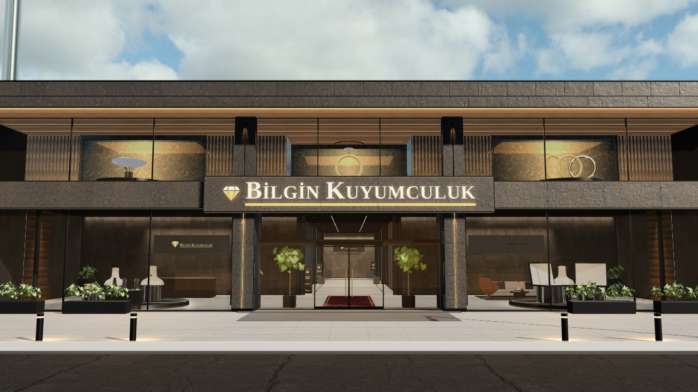
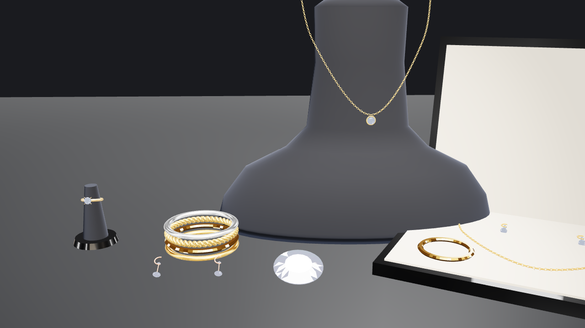

# Bilgin Kuyumculuk 3D mağaza (yarım, beklemede)

Garden Motors sitesinin kopyası (aynı bina ve ışık kalitesi), kuyumcuya çevriliyor. **Durum: cephe bitti, iç salonlar yapılmadı.**

Yapılanlar
- Ad, logo (pırlanta + şampanya altını, `public/brand/logo*.png`), 3B tabela (`TH.sign.words`, Liberation Serif Bold harfleri),
  oda duvarlarındaki marka yazısı (Cinzel; İ harfi I + noktadan), sayfa metinleri, WhatsApp bağlantıları. Telefon: 0533 542 30 90.
- `src/jewelry/jewelry.js`: kodla üretilen mücevher kiti (lisans gerekmez): pırlanta (yuvarlak kesim, fasetli), tektaş yüzük, bilezik
  (düz / elmas kesim / burma), zincir kolye (pırlanta veya madalyon uçlu), küpe, kadife büst, yüzük konisi, gelin seti kutusu;
  mücevher stüdyosu ortamı (`jewelryEnv`: koyu oda + softbox; pırlanta için açık tonlu ayrı ortam).
- Cephe vitrinleri (`VITRINE`, `vitrineJewel`): üstte dev tektaş yüzük heykeli (sağa-sola döner), dev pırlanta (döner), altın bilezik
  üçlüsü; zemin katta kolye büstleri + yüzük konileri + bilezikler, gelin setleri.

Kalanlar
- Sol üst dev pırlantanın kaidesi (uzaktan lamba gibi görünüyor).
- İç salonlar: araç yerine ışıklı cam vitrin tezgahları, ürün kartı (ayar / gram / taş / fiyat), 360° ürün inceleme
  (`CARS` → ürün listesi). Şu an içeride hâlâ araç salonları var.

Çalıştırmak için Garden Motors'taki `models/`, `public/textures`, `public/hdri`, `textures/` klasörleri bu klasöre kopyalanır
(`models/vitrin` gerekmez).

